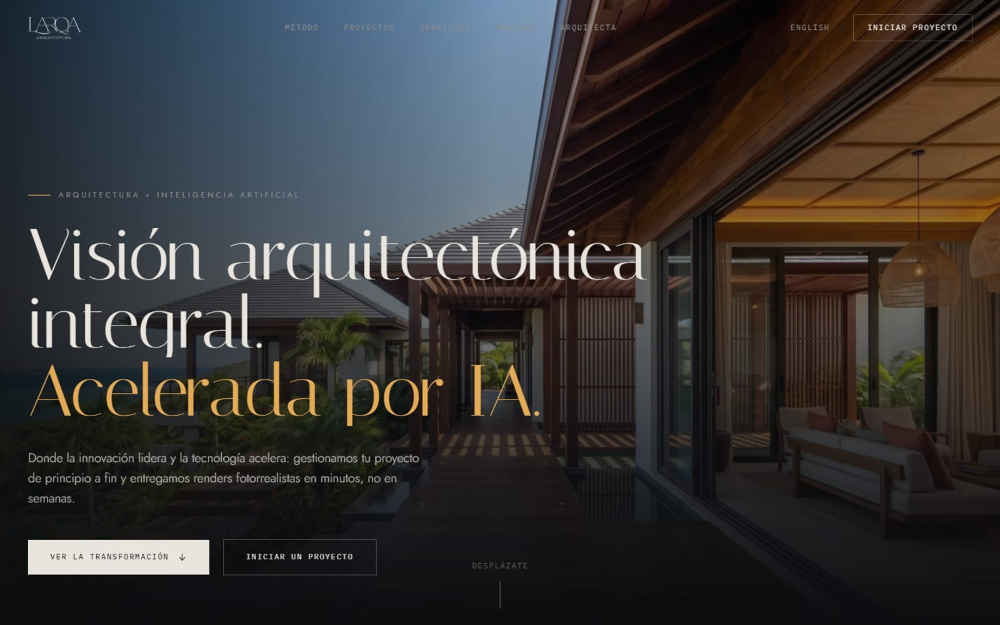
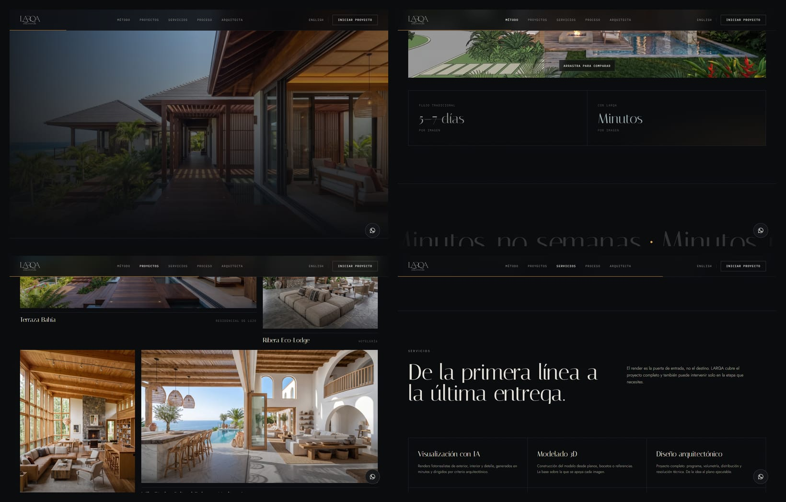
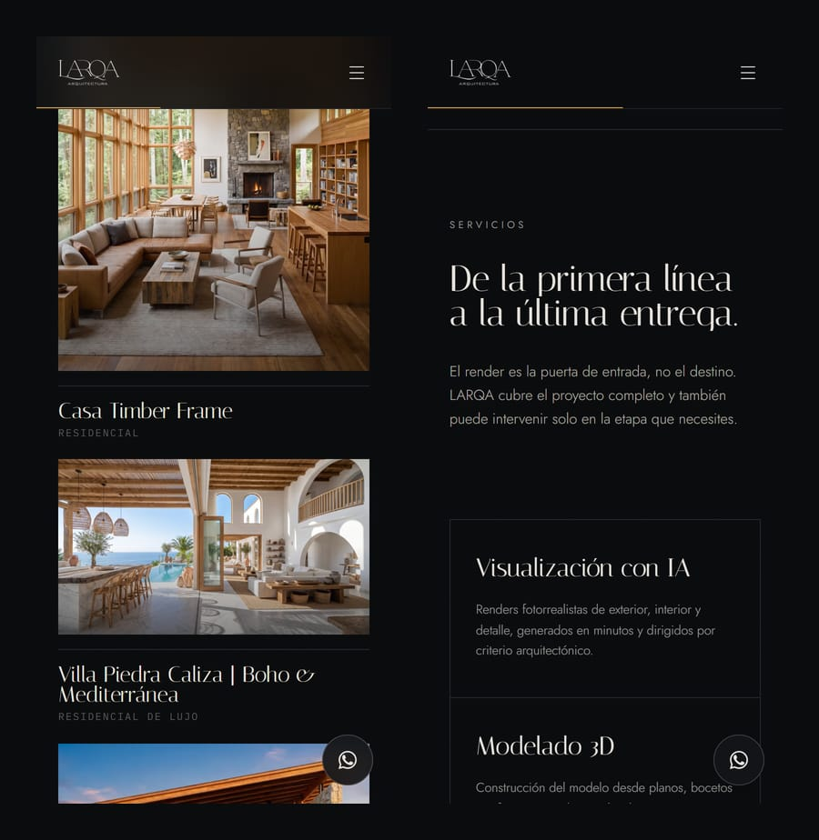

<div align="center">



# LARQA · Arquitectura

**The architecture practice of Laura Martínez, presented as a calibrated viewport: the site does not describe AI-accelerated visualization — it demonstrates it, from untextured 3D model to photoreal render, under your cursor.**

<br/>

[](https://www.larqa.co/)
[](https://github.com/Kin9Zeus/LarqaWebDL/actions/workflows/ci.yml)


</div>

---

## Highlights

| | |
|---|---|
| 🎚️ **A comparator that is the argument** | The signature element: one frame in two states — the untextured 3D model and the final render. Underneath is a real `<input type="range">` at zero opacity, so keyboard and touch dragging work natively. The slider position drives `--reveal`, and the whole section's accent travels from draft blue (`#5fa8d3`) to render amber (`#e4a853`) as you drag. |
| 🎞️ **A hero that tells the process** | One continuous shot: drawing → 3D model → render → built work. Scrubbed by scroll on desktop, a muted loop on mobile. The Veo 3.1 prompts and encoding spec are in [`docs/hero-video.md`](docs/hero-video.md). |
| ⏱️ **"Minutes, not weeks"** | The speed section sets the traditional 5–7 days per image against minutes with LARQA, under the page's one loud typographic marquee. |
| 🖼️ **An editorial gallery that never shifts** | Nine *model → render* pairs on a 12-column grid. A script derives WebP files plus each image's dimensions and a base64 blur placeholder, so nothing moves on load. |
| 🌐 **Properly bilingual** | `/es` and `/en` with `Accept-Language` detection in `proxy.ts`. `es.json` defines the dictionary type, so a missing English key fails the build. |
| ✨ **Motion as progressive enhancement** | Scroll entrances never depend on JavaScript: if it fails, the page is still complete. A trailing ring cursor opens over interactive elements without hiding the native cursor. |
| ✉️ **A safe contact form** | Every field is validated and escaped before it is templated into the email Resend sends. |

## Screenshots

<div align="center">
  
  <br/><sub><b>Desktop</b> — hero, comparator and speed, editorial gallery and services.</sub>
  <br/><br/>
  
  <br/><sub><b>Mobile</b></sub>
</div>

---

## Stack

- Next.js 16 (App Router, Turbopack) · React 19 · TypeScript
- Tailwind CSS v4 (tokens defined in `app/globals.css`)
- Framer Motion
- Resend (contact form delivery)
- `sharp` (build-time image derivation, dev dependency only)

## Getting started

```bash
npm install
npm run dev
```

Then open <http://localhost:3000> — you will be redirected to `/es` or `/en`
depending on your browser's `Accept-Language`.

### Environment

Create `.env.local`:

```
RESEND_API_KEY=re_xxxxxxxxxxxx
NEXT_PUBLIC_WHATSAPP_NUMBER=573001234567
```

`NEXT_PUBLIC_WHATSAPP_NUMBER` is digits only — country code first, no `+` and no
spaces. Without it the site falls back to the placeholder in `app/lib/site.ts`.

## Structure

```
app/
  [locale]/          es | en — layout, landing page, 404
  api/contact/       Resend handler (validates + escapes before templating)
  components/        Section and chrome components
  lib/
    dictionaries/    All copy, one JSON per locale
    i18n.ts          Locale config; es.json is the source of truth for the type
    projects.ts      Merges the image manifest with localized titles
    site.ts          Real-world contact details and section anchor ids
proxy.ts             Locale detection and redirect (Next 16's middleware)
scripts/             Image and brand asset generation
docs/hero-video.md   Veo 3.1 prompts + encoding spec for the hero film
```

### Editing copy

All text lives in `app/lib/dictionaries/es.json` and `en.json`. The two files
must stay structurally identical — `es.json` defines the `Dictionary` type, so
if a key is missing from `en.json` the build fails with a type error. That is
intentional: it makes an untranslated string impossible to ship.

## Assets

### Project imagery

The nine `3D model → AI render` pairs are the core of the site. Raw sources live
in `3D a Render imagenes/` (git-ignored, ~57 MB). The committed, web-ready
derivatives in `public/work/` (~7 MB) are generated from them:

```bash
node scripts/optimize-work-images.mjs
```

This writes WebP derivatives plus `app/lib/work-manifest.json`, which carries
each image's dimensions and a base64 blur placeholder so nothing shifts on load.
Adding a new pair means dropping two files named `<project>_modelo_3d.<ext>` and
`<project>_render.<ext>` into the source folder, re-running the script, and
adding a title for the new slug to both dictionaries.

### Brand assets

```bash
node scripts/make-brand-assets.mjs
```

Derives `public/logo-light.png` (the wordmark in bone on transparency, for the
dark navbar) and `public/og.jpg` (the 1200×630 social card) from `logo.png` and
the villa render.

### Favicon

```bash
node scripts/make-favicon.mjs --preview
```

Writes `app/favicon.ico` (16/32/48) plus `public/icon-192.png`,
`public/icon-512.png` and `public/apple-icon.png`.

The wordmark cannot be the favicon — it is 2.3:1, and squaring it produced the
illegible smear this replaced. The mark is a capital L drawn in the logo's voice
(heavy stem, light arm, flared bracket serifs) rather than a trace of the logo's
own glyph, which is closer to a capital I and only reads as an L thanks to the
swash under the wordmark; that swash turns to mush below 32px.

The 16 and 32px rasters come from a heavier cut of the same skeleton, because
the fine cut's arm disappears at that scale. `--preview` writes each size to
`scratch-favicon/` for inspection.

### Hero video

Not in the repo yet. The hero falls back to a still until the files land — see
[`docs/hero-video.md`](docs/hero-video.md) for the generation prompts and the
required encoding.

## Design notes

The page is a calibrated viewport: the chrome is achromatic graphite so the only
colour on screen comes from the work itself. The two accents are not decorative
— they are the two states of that work. `--color-draft` is the cool untextured
3D model, `--color-render` is the warm photoreal result, and the comparator
drives `--reveal` from 0 to 1 so the accent physically travels between them.

Type mirrors the logo: **Italiana** for display (the high-contrast didone
wordmark) and **Jost** for everything else (the wide-tracked geometric sans of
the "ARQUITECTURA" lockup). IBM Plex Mono carries technical annotation.

`--accent` is declared on `.accent-scope`, not on `:root` — custom properties
resolve their `var()` references at the element where they are declared, so a
`:root` declaration would freeze `--reveal` at 0 for every descendant.

## License

© 2026 Devleck (Aleck Martinez). **All rights reserved.** The code is published as a portfolio case study: you may read it and run it locally to evaluate it, but you may not copy, redistribute or use it in another product without written permission. Brand names, logos, photographs and texts belong to their respective owners. See [LICENSE](LICENSE) · Permissions: contact@devleck.com
